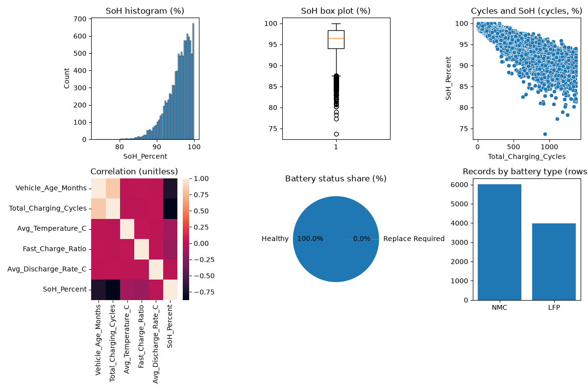

# EV Battery Health Prediction

This beginner project predicts battery State of Health (SoH, %) from five measurements. The supplied Kaggle CSV has **10,000 rows and 13 columns**. Kaggle describes it as **synthetic**, not real battery-test data. The course asks for real-world data, so get teacher approval or replace this CSV before submission.

## Dataset columns and units

- `Vehicle_ID`: ID; no physical unit.
- `Car_Model`, `Battery_Type`, `Driving_Style`, `Battery_Status`: text categories.
- `Battery_Capacity_kWh`: capacity (kWh); not used as an input.
- `Vehicle_Age_Months`: age (months); model input.
- `Total_Charging_Cycles`: charge cycles (cycles); model input.
- `Avg_Temperature_C`: temperature (°C); model input.
- `Fast_Charge_Ratio`: fast-charge share (0 to 1; unitless); model input.
- `Avg_Discharge_Rate_C`: discharge rate (C-rate); model input.
- `Internal_Resistance_Ohm`: resistance (Ω); not used as an input.
- `SoH_Percent`: battery health (%); prediction target.

## Folder structure

```text
Dataset/
└── EV_Battery_Dataset.csv
Python_Code/
├── project.py
└── best_model.pkl
Reports/
├── eda_charts.png
├── EDA_Report.html
└── Project_Report.pdf
main.py
requirements.txt
LEARNING_GUIDE.md
VIVA_QUESTIONS.md
```

## How to run

Open PowerShell in the project folder:

```powershell
py -3.12 -m venv .venv
.\.venv\Scripts\Activate.ps1
python -m pip install -r requirements.txt
python Python_Code\project.py
```

The script prints the results, saves six charts together in `Reports/eda_charts.png`, and saves the selected model in `Python_Code/best_model.pkl`. It uses direct, beginner-level Linear, Ridge, and Lasso models. It does not scale the inputs because scaling is outside the requested beginner code style; Ridge and Lasso scores can be affected by the different units.

The included `Reports/Project_Report.pdf` has blank student details to fill in. `Reports/EDA_Report.html` is an optional report created separately; neither extra report package nor PDF-writing code is imported by the beginner project script.



## Results from this CSV

The run found **0 missing values**, **0 duplicate rows**, and capped **101** unusual input values. It kept **10,000 rows** and used **8,000 training rows / 2,000 test rows**.

| Model | 5-fold CV R² (unitless) | MAE (%) | MSE (%²) | RMSE (%) | Test R² (unitless) |
|---|---:|---:|---:|---:|---:|
| Linear | 0.8008 | 1.0687 | 2.2163 | 1.4887 | 0.7916 |
| Ridge | 0.8008 | 1.0687 | 2.2163 | 1.4887 | 0.7916 |
| Lasso | 0.7894 | 1.0779 | 2.3229 | 1.5241 | 0.7815 |

The displayed Linear and Ridge cross-validation scores tie when rounded to four decimals. The script chooses Linear for that displayed tie. A sample battery with age **68 months**, **432 cycles**, temperature **24.3 °C**, fast-charge ratio **0.91**, and discharge rate **0.61 C-rate** had actual SoH **97.31%** and predicted SoH **95.41%**.

Simple line: **SoH (%) = -0.009001 (% per cycle) × cycles + 99.920179 (%)**. Its R² was **0.7628** (unitless; teaching fit on all cleaned rows).

## Limitations and future work

- The data is synthetic. These results do not show real battery performance.
- A random row split may put similar simulated records in training and test data.
- Outlier limits are calculated before the train/test split in this beginner workflow.
- Use an approved, measured battery dataset and test on different batteries.
- Consider input units before comparing regularized models; this simple code does not scale features.
- Never use these predictions for repair or safety decisions.

## Time estimate

| Step | Time |
|---|---:|
| 1. Load data | 10 min |
| 2. Understand data | 20 min |
| 3. Clean data | 30 min |
| 4. Make six charts | 35 min |
| 5. Fit simple regression | 20 min |
| 6. Split data | 10 min |
| 7. Train three models | 35 min |
| 8. Evaluate models | 20 min |
| 9. Save and predict | 10 min |
| **Total** | **About 3 hours 10 minutes** |

## Six GitHub upload steps

Run these from your project folder. Replace `YOUR_USERNAME` with your GitHub name.

1. Start Git:
   `git init`
2. Name the main branch:
   `git branch -M main`
3. Select the project files:
   `git add .`
4. Make the first save:
   `git commit -m "Add EV battery project"`
5. Connect your GitHub repository:
   `git remote add origin https://github.com/YOUR_USERNAME/EV_Battery_Health_Prediction.git`
6. Upload the files:
   `git push -u origin main`

## Five common mistakes

1. Calling synthetic records real measurements. Say they are synthetic.
2. Using `Vehicle_ID` as a measurement. Leave it out.
3. Predicting with `Battery_Status`. It is another target, not an input.
4. Running the command outside the project folder. Run it from the project root.
5. Treating the score as real battery accuracy. Test with measured data first.

## Final checklist

- [ ] Ask the teacher to approve this synthetic dataset or use approved real measurements.
- [ ] Fill in your name and roll number in the report.
- [ ] Keep the CSV, Python file, charts, and report in the correct folders.
- [ ] Run the code and check the output before explaining it in viva.
- [ ] Explain that the results are only for simulated data.

## Author

**Name:** Add your name

**Course:** BCA Sem-III, 303-05 Fundamentals of Machine Learning
