# EV Battery Health Prediction

## 1. Problem and objective

**Problem:** Estimate an electric-vehicle battery's State of Health (SoH, %).

**Objective:** Learn a Linear Regression model from battery measurements and compare one input with five inputs.

> **Dataset warning:** Kaggle describes this 10,000-row dataset as synthetic simulations, not measured battery tests. The course asks for real-world data. Ask your teacher to approve this learning dataset or use an approved measured dataset before submitting.

## 2. Dataset

Source: [Electric Vehicle (EV) Battery Degradation and Charge](https://www.kaggle.com/datasets/bertnardomariouskono/electric-vehicle-ev-battery-degradation-and-charge).

The supplied CSV has **10,000 rows and 13 columns**.

| Column | Meaning | Unit or kind |
|---|---|---|
| `Vehicle_ID` | Record identifier | ID; no physical unit |
| `Car_Model` | Vehicle model | Category |
| `Battery_Type` | Battery chemistry | Category |
| `Battery_Capacity_kWh` | Listed battery capacity | kWh |
| `Vehicle_Age_Months` | Vehicle age | months |
| `Total_Charging_Cycles` | Total charge cycles | cycles |
| `Avg_Temperature_C` | Average temperature | °C |
| `Fast_Charge_Ratio` | Share of fast charging | 0 to 1; unitless |
| `Avg_Discharge_Rate_C` | Average discharge rate | C-rate |
| `Driving_Style` | Driving style | Category |
| `Internal_Resistance_Ohm` | Internal resistance | ohms (Ω) |
| `SoH_Percent` | Battery State of Health | %; target |
| `Battery_Status` | Battery status | Category |

We do not use the ID, categories, capacity, or resistance as model inputs. Capacity and resistance may reveal information closely linked to SoH and make the score look too good.

## 3. Materials

- Windows, PowerShell, and Python **3.12.10**.
- The Python libraries are pandas, NumPy, Matplotlib, Seaborn, and scikit-learn.
- Install them with: `python -m pip install -r requirements.txt`

## 4. Folder structure

```text
Dataset/
└── EV_Battery_Dataset.csv
Python_Code/
└── project.py
Reports/
├── data_cleaning.png
├── dataset_summary.png
├── feature_split.png
├── soh_histogram.png
├── soh_boxplot.png
├── cycles_vs_soh.png
├── correlation_heatmap.png
├── battery_status_pie.png
├── battery_type_bar.png
├── simple_regression_line.png
├── model_results.png
├── sample_prediction.png
└── deployment_prediction.png
requirements.txt
README.md
```

## 5. The Machine Learning life cycle

### Stage 1 — Problem definition

**Meaning:** Decide what question the model will answer.
We predict SoH (%) from battery measurements.

```text
Question: What is this battery's State of Health (SoH, %)?
```

### Stage 2 — Data collection

**Meaning:** Collect data that can help answer the question.
Here we load the supplied CSV and inspect its rows, columns, types, and summaries.

```python
df = pd.read_csv("Dataset/EV_Battery_Dataset.csv")  # Load the supplied CSV.
print("Shape (rows, columns):", df.shape)  # Show the dataset size.
print(df.head())  # Show the first five records.
df.info()  # Show column names and data types.
print(df.describe())  # Summarize numeric columns.
```

**Result:** The CSV contains **10,000 rows × 13 columns**, 8 number columns, and 5 text columns.

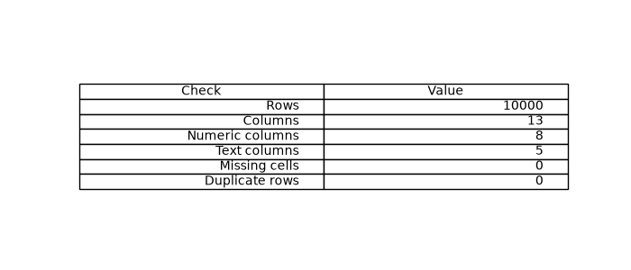

The summary image shows the CSV row, column, type, blank-cell, and duplicate counts.

### Stage 3 — Data cleaning and preparation

**Meaning:** Check blank values, repeated rows, and unusual measurements.
We remove duplicate or blank rows and cap unusual values in the five inputs.

```python
feature_columns = ["Vehicle_Age_Months", "Total_Charging_Cycles", "Avg_Temperature_C", "Fast_Charge_Ratio", "Avg_Discharge_Rate_C"]  # Choose inputs.
outliers_before = 0  # Start counting input outliers.
for col in feature_columns:  # Check each input column.
    q1 = df[col].quantile(0.25)  # Find the lower quarter.
    q3 = df[col].quantile(0.75)  # Find the upper quarter.
    low = q1 - 1.5 * (q3 - q1)  # Find the lower limit.
    high = q3 + 1.5 * (q3 - q1)  # Find the upper limit.
    outliers_before += ((df[col] < low) | (df[col] > high)).sum()  # Count unusual values.
df = df.drop_duplicates()  # Remove duplicate rows.
df = df.dropna()  # Remove rows with missing values.
for col in feature_columns:  # Clean each input column.
    q1 = df[col].quantile(0.25)  # Find its lower quarter.
    q3 = df[col].quantile(0.75)  # Find its upper quarter.
    low = q1 - 1.5 * (q3 - q1)  # Find the lower limit.
    high = q3 + 1.5 * (q3 - q1)  # Find the upper limit.
    df[col] = df[col].clip(low, high)  # Cap unusual input values.
```

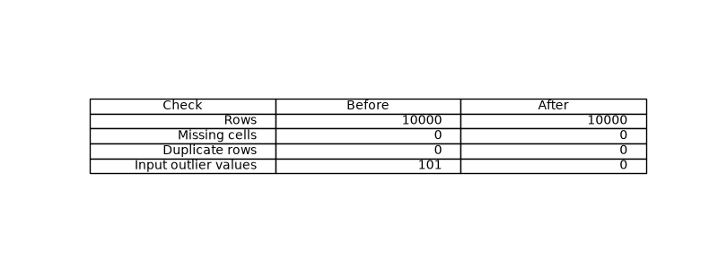

The check found **0 missing cells**, **0 duplicate rows**, and **101 input outlier values**; after cleaning, **10,000 rows** remained and **0 outliers** were counted.

### Stage 4 — Exploratory Data Analysis (EDA)

**Meaning:** Use charts to look for patterns and unusual values.
We draw six charts; the heatmap values are unitless correlations.

```python
plt.figure()  # Start a histogram.
sns.histplot(df["SoH_Percent"])  # Show SoH values (%).
plt.savefig("Reports/soh_histogram.png")  # Save the histogram.
plt.figure()  # Start a box plot.
plt.boxplot(df["SoH_Percent"], orientation="vertical")  # Show SoH spread (%).
plt.savefig("Reports/soh_boxplot.png")  # Save the box plot.
plt.figure()  # Start a scatter plot.
plt.scatter(df["Total_Charging_Cycles"], df["SoH_Percent"])  # Compare cycles and SoH.
plt.savefig("Reports/cycles_vs_soh.png")  # Save the scatter plot.
plt.figure()  # Start a heatmap.
sns.heatmap(df[feature_columns + ["SoH_Percent"]].corr(), annot=True)  # Show unitless correlations.
plt.savefig("Reports/correlation_heatmap.png")  # Save the heatmap.
plt.figure()  # Start a pie chart.
plt.pie(df["Battery_Status"].value_counts(), labels=df["Battery_Status"].value_counts().index)  # Show status shares.
plt.savefig("Reports/battery_status_pie.png")  # Save the pie chart.
plt.figure()  # Start a bar chart.
plt.bar(df["Battery_Type"].value_counts().index, df["Battery_Type"].value_counts().values)  # Count records.
plt.savefig("Reports/battery_type_bar.png")  # Save the bar chart.
```

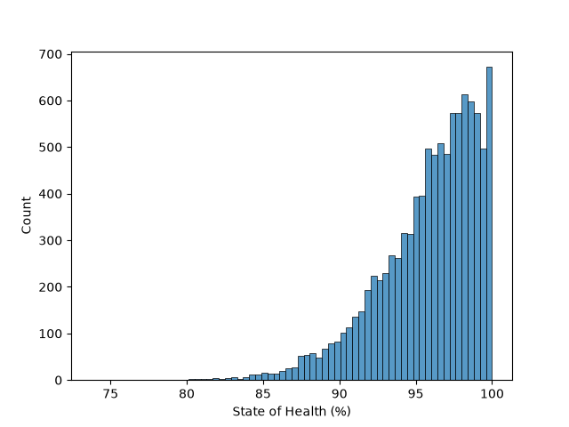

Most records have SoH values near the high end of the **%** scale.

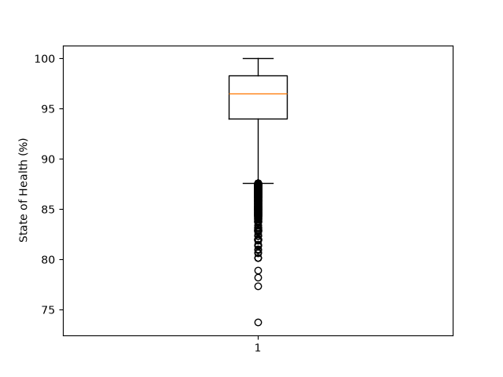

The box plot shows the spread and unusually low SoH records (**%**).

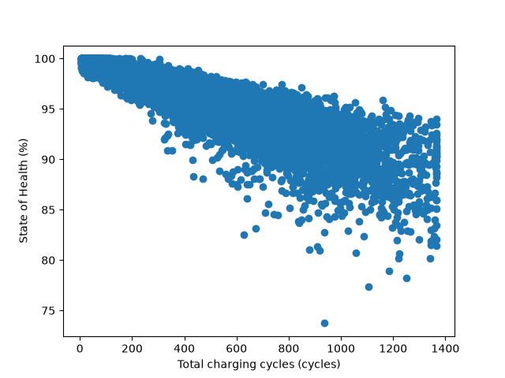

The scatter plot compares charging cycles with SoH (**cycles**, **%**).

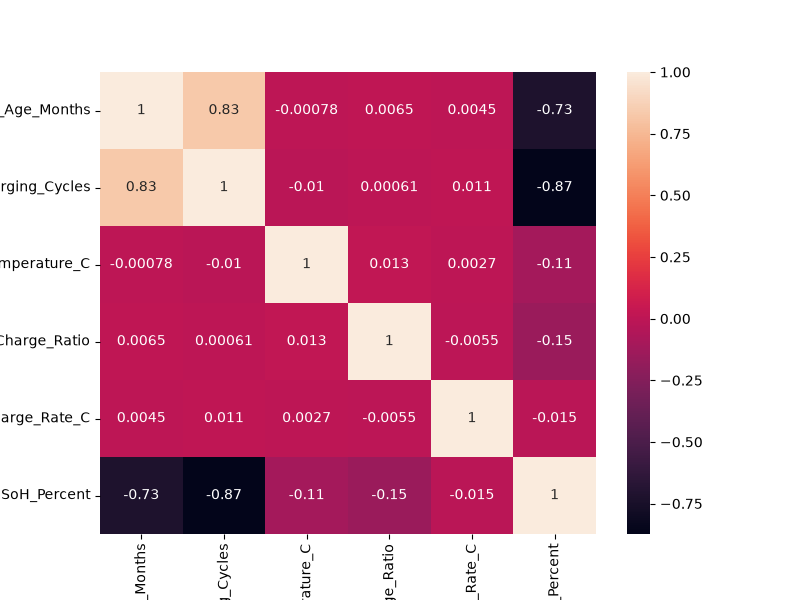

The heatmap shows how numeric columns move together; correlation has no unit.

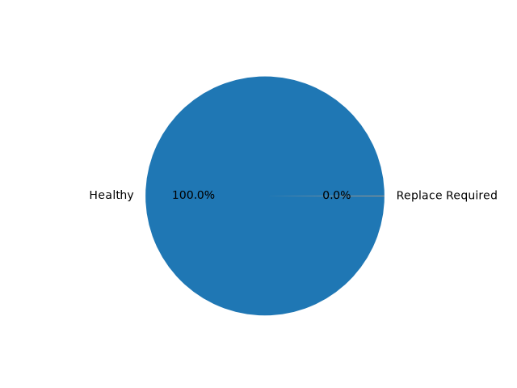

The pie chart shows the share of each battery-status category (**%**).

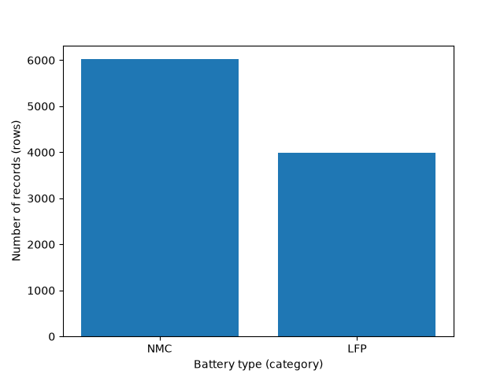

The bars count records for each battery type (**rows**).

### Stage 5 — Feature selection and train/test split

**Meaning:** Choose the input columns and the answer column.
Keep some rows aside so the model can be checked on examples it did not train on.

```python
X = df[feature_columns]  # Use five selected input measurements.
y = df["SoH_Percent"]  # Predict battery health (%).
X_train, X_test, y_train, y_test = train_test_split(X, y, test_size=0.20, random_state=42)  # Split 80/20.
print("Training rows:", len(X_train), "| Test rows:", len(X_test))  # Show split sizes.
```

**Result:** **8,000 training rows** and **2,000 test rows**. The inputs use months, cycles, °C, a unitless ratio, and C-rate.

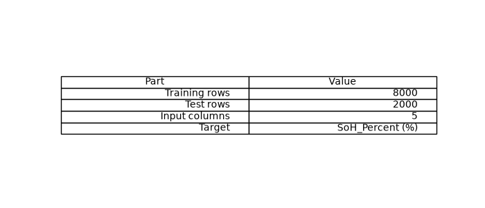

The image shows the training/test row counts, five input columns, and the SoH target (%).

### Stage 6 — Model training

**Meaning:** The model learns a relationship between inputs and known answers.
Simple Linear Regression uses cycles; multiple Linear Regression uses five inputs.

```python
model_simple = LinearRegression()  # Make a one-input model.
model_simple.fit(X_train[["Total_Charging_Cycles"]], y_train)  # Learn from cycles.
model = LinearRegression()  # Make a five-input model.
model.fit(X_train, y_train)  # Learn from five measurements.
```

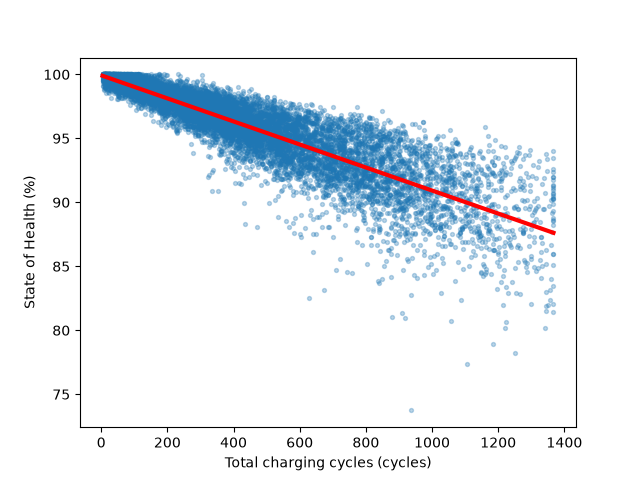

The red line is the simple model's fitted SoH (**%**) trend over charging cycles (**cycles**).

### Stage 7 — Model evaluation

**Meaning:** Compare predictions with answers from the held-out test rows.
MAE and RMSE use percentage points (**%**); MSE uses **%²**; R² is unitless.

```python
simple_prediction = model_simple.predict(X_test[["Total_Charging_Cycles"]])  # Predict using cycles.
prediction = model.predict(X_test)  # Predict using five inputs.
results = pd.DataFrame()  # Start a result table.
results["Model"] = ["Simple Linear", "Multiple Linear"]  # Name each model.
results["MAE (%)"] = [mean_absolute_error(y_test, simple_prediction), mean_absolute_error(y_test, prediction)]  # Add MAE.
results["MSE (% squared)"] = [mean_squared_error(y_test, simple_prediction), mean_squared_error(y_test, prediction)]  # Add MSE.
results["RMSE (%)"] = [np.sqrt(mean_squared_error(y_test, simple_prediction)), np.sqrt(mean_squared_error(y_test, prediction))]  # Add RMSE.
results["R2 (unitless)"] = [r2_score(y_test, simple_prediction), r2_score(y_test, prediction)]  # Add R2.
print(results.round(4))  # Show the scores.
```

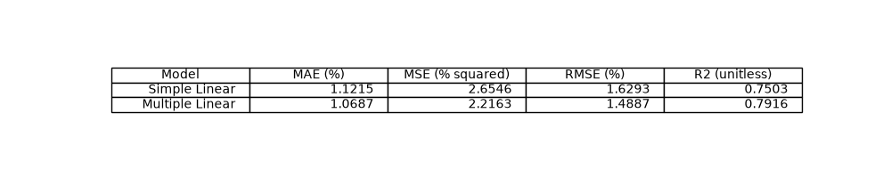

Multiple Linear Regression performed better on this test split: lower errors and higher R² (unitless).

### Stage 8 — Prediction

**Meaning:** Try the trained model on one test row it did not learn from.
Compare the prediction with that row's actual SoH (**%**).

```python
sample = X_test.iloc[[0]]  # Select one held-out battery.
sample_actual = y_test.iloc[0]  # Read its actual SoH (%).
sample_prediction = model.predict(sample)[0]  # Predict its SoH (%).
print("Actual SoH (%):", sample_actual)  # Show the actual answer.
print("Predicted SoH (%):", sample_prediction)  # Show the prediction.
```

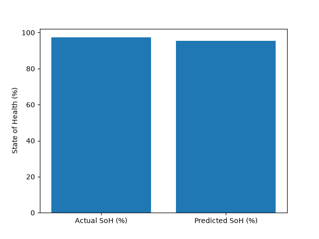

For this sample, actual SoH was **97.31%** and predicted SoH was **95.41%**.

### Stage 9 — Deployment

**Meaning:** Use the trained model to predict a new set of measurements.
Publishing the project on GitHub lets other students download and run it.

```python
age_input = float(input("Vehicle age in months: "))  # Enter age.
cycles_input = float(input("Total charging cycles (cycles): "))  # Enter cycle count.
temperature_input = float(input("Average temperature (°C): "))  # Enter temperature.
charge_input = float(input("Fast-charge ratio (0 to 1): "))  # Enter charge ratio.
discharge_input = float(input("Average discharge rate (C-rate): "))  # Enter discharge rate.
new_sample = pd.DataFrame([[age_input, cycles_input, temperature_input, charge_input, discharge_input]], columns=feature_columns)  # Arrange inputs.
new_soh = model.predict(new_sample)[0]  # Predict new SoH (%).
print("Predicted new battery SoH (%):", new_soh)  # Show the result.
```

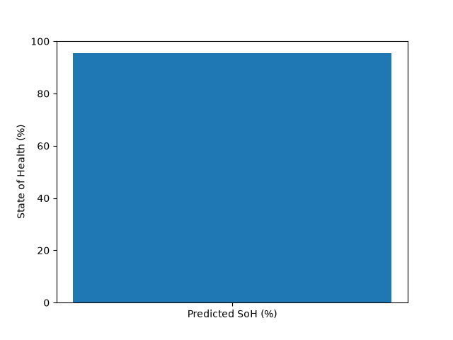

This image shows the new SoH estimate (**%**) from the five values entered in the terminal.

**Six GitHub steps** (replace `YOUR_USERNAME` with your GitHub name):

1. `git init`
2. `git branch -M main`
3. `git add .`
4. `git commit -m "Add EV battery health project"`
5. `git remote add origin https://github.com/YOUR_USERNAME/EV_Battery_Health_Prediction.git`
6. `git push -u origin main`

### Stage 10 — Monitoring

Later, compare predictions with newly measured battery SoH (**%**). Check model errors, unusual input values, and whether the battery data has changed. Re-train only with approved, measured data.

## 6. Results from the real run

The code was run on the supplied CSV. It used **8,000 training rows** and **2,000 test rows**.

| Model | MAE (%) | MSE (%²) | RMSE (%) | R² (unitless) |
|---|---:|---:|---:|---:|
| Simple Linear | 1.1215 | 2.6546 | 1.6293 | 0.7503 |
| Multiple Linear | 1.0687 | 2.2163 | 1.4887 | 0.7916 |

Simple line from this run: **SoH (%) = -0.009002 (% per cycle) × cycles + 99.926530 (%)**.

## 7. Deployment: use a new sample

Run the script and enter age (**months**), cycles (**cycles**), temperature (**°C**), fast-charge ratio (**unitless**), and discharge rate (**C-rate**) when asked. It prints estimated SoH (**%**) and saves `Reports/deployment_prediction.png`.

The GitHub steps above publish the files so another student can download and run them.

## 8. Run it as another student

Clone the GitHub repository, then open PowerShell in that folder:

```powershell
git clone https://github.com/YOUR_USERNAME/EV_Battery_Health_Prediction.git
cd EV_Battery_Health_Prediction
py -3.12 -m venv .venv
.\.venv\Scripts\Activate.ps1
python -m pip install -r requirements.txt
python Python_Code\project.py
```

The last command asks for five input values. Enter the units shown in the prompts.

## 9. Limitations, future work, and author

**Limitations**
- Kaggle says this dataset is synthetic, not real battery measurements.
- Capacity and internal resistance can be strongly linked to SoH. Using them may cause target leakage and an unrealistically high R².
- Outlier limits are calculated before the train/test split in this simple student project.
- Do not use these predictions for safety or repair decisions.

**Future work:** Get teacher approval and measured battery data. Test on different batteries and compare predictions with measured SoH.

**Author:** Add your name.
**Course:** BCA Sem-III, 303-05 Fundamentals of Machine Learning.

## 10. Viva questions

1. **What does the model predict?**
   It predicts battery State of Health. The answer is a percentage (%).

2. **What is the target column?**
   `SoH_Percent` is the target. It is the value the model learns to predict.

3. **Is this real battery data?**
   No. Kaggle describes it as synthetic simulations. The teacher must approve it for this project.

4. **What is regression?**
   Regression predicts a number. This project predicts SoH (%).

5. **What is a feature?**
   A feature is an input used by the model. Examples are cycles and temperature.

6. **Why split the data?**
   The model learns from training rows. Test rows check how well it predicts unseen records.

7. **What is simple Linear Regression?**
   It uses one input, charging cycles. Its line has the form `y = mx + b`.

8. **What is multiple Linear Regression?**
   It uses more than one input. Here it uses five selected measurements.

9. **What do MAE and R² mean?**
   MAE is average prediction error in SoH percentage points (%). R² is a unitless score.

10. **Can this model diagnose a real battery?**
    No. It was tested on synthetic data only. Real measured data is needed.

## 11. Common mistakes and time needed

**Five common mistakes**
1. Calling synthetic data real. Always state it is simulated.
2. Using `Vehicle_ID` as a measurement. It is only an identifier.
3. Using battery capacity without checking leakage. It may be linked to the target.
4. Entering a ratio as a percent. The program expects a value from 0 to 1.
5. Treating the test score as real-world accuracy. It only describes this CSV.

**Estimated time:** Stage 1—10 minutes; 2—20; 3—30; 4—40; 5—15; 6—25; 7—20; 8—10; 9—15; 10—10. **Total: about 3 hours 15 minutes.**

## Final checklist

- [ ] Ask the teacher whether this synthetic dataset is acceptable or use approved real measurements.
- [ ] Check that all 11 PNG images appear above.
- [ ] Run `python Python_Code\project.py` and enter the five values with the correct units.
- [ ] Fill in your name before sharing the project.
- [ ] Explain that the model is for learning, not real battery decisions.
